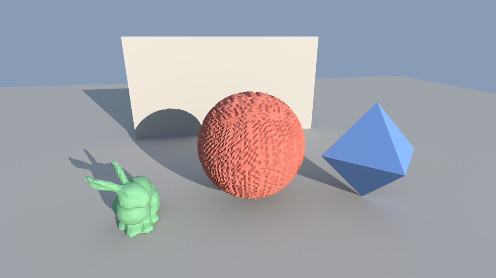
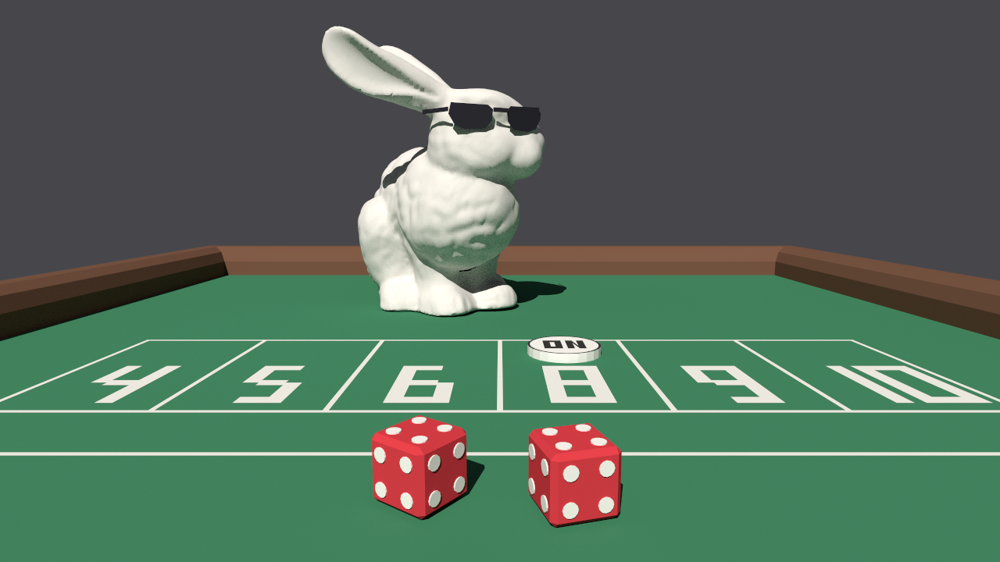
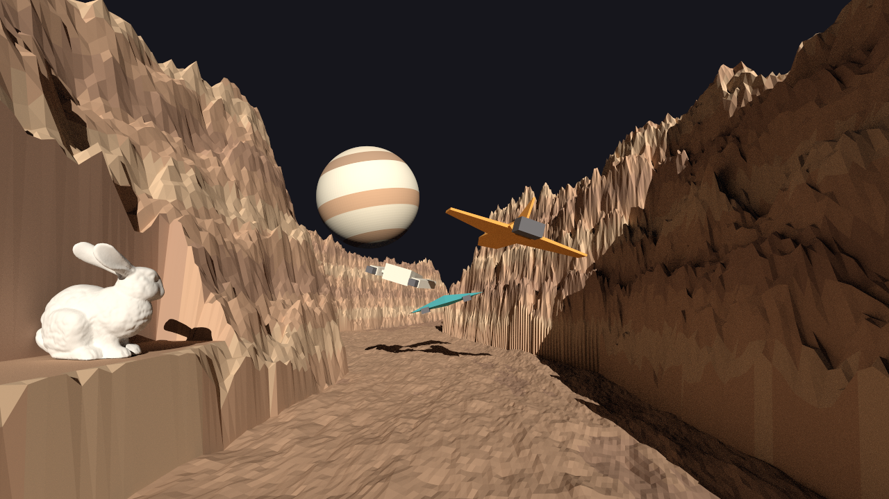

# Lumen

Lumen is a ray tracer that renders the same image bytes on every machine: a
[Geordi](https://github.com/flyingrobots/geordi) runtime built on
[Bunny](https://github.com/flyingrobots/bunny)'s fixed-point math.



*The reference scene, `lumen-reference-scene/4`, 1280 by 720 at 64 samples per pixel.*

A render has the same bytes, and so the same image hash, on every run, at every thread count, and
on every platform CI checks: x86-64 and aarch64 Linux, aarch64 macOS, x86-64 Windows and
WebAssembly (`wasm32-wasip1`). Each part of that claim is mapped to the tests that check it in the
[evidence map](docs/explanation.md#requirements-and-their-evidence). Every sample is one diffuse
path with a shadow ray and one bounce, all in Bunny's integer arithmetic, and the image is written
as a PNG.

## The three built-in scenes

Each image below is a render by Lumen at 1280 by 720, 64 samples per pixel and seed 0, re-encoded
losslessly into a smaller PNG file. Its pixels are exactly the render's: the image hash is
SHA-256 over the decoded RGBA8 bytes and identifies an image only together with its size
([ADR 0009](docs/adr/0009-image-hash.md)). Each output excerpt below is abridged: the two lines
shown are exact, in the order the command prints them, and the other lines of the report are
omitted.

The reference scene (above) is a bumpy sphere, an octahedron and the Stanford bunny before a wall.

```sh
cargo run --release -p lumen -- render --scene reference --width 1280 --height 720 --samples 64 --out reference.png
```

```text
size 1280x720
image sha256:7d68fa3ab47c19ba6cee947836b49ad52e4e0891f2a4b41562192576d1700a6e
```

Fixed Point is the full-resolution bunny in sunglasses at a craps table.



```sh
cargo run --release -p lumen -- render --scene fixed-point --width 1280 --height 720 --samples 64 --out fixed-point.png
```

```text
size 1280x720
image sha256:86cdfd58d7745297b52f63f443cedd789a773996c66ad57d45b5d8a6f67fb153
```

The canyon is three craft flying along a fractal canyon under a banded planet (566 005 triangles).



```sh
cargo run --release -p lumen -- render --scene canyon --width 1280 --height 720 --samples 64 --out canyon.png
```

```text
size 1280x720
image sha256:1bd910dcea9c3daaa3ea57e3972a639202aa341ba59e0e075a2e55184dc56446
```

## Render an image

With a Rust toolchain ([rustup](https://rustup.rs/); the checkout pins Rust 1.96.0):

```sh
git clone https://github.com/flyingrobots/lumen
cd lumen
cargo run --release -p lumen -- render --out first.png
```

The report holds the image hash of the reference scene at the default 320 by 180, 4 samples per
pixel, the same on every platform CI checks (abridged: the two lines shown are exact, and the
other lines of the report are omitted):

```text
image sha256:d6e4ff7d768e266a30e54a04d62f6a13aeeebd2f6f68f8783faaaff9c7f505a8
png first.png (230699 bytes)
```

To render all three scenes at the size above, run the three commands in the previous section; the
canyon takes the longest. Maintainers with the container runner `devrun` run `make demo`, which
renders them into `out/` and opens each image.

The [tutorial](docs/tutorial.md) goes on from there.

## Documentation

- Learn: [render your first image](docs/tutorial.md).
- Look up: [the `lumen` command](docs/reference/cli.md), [the library](docs/reference/library.md),
  [the built-in scenes](docs/reference/scenes.md).
- Understand: [how Lumen renders, and why the image is the same everywhere](docs/explanation.md).
- Measure: [measure render time](docs/how-to/measure-performance.md).
- Decisions and records: the [documentation index](docs/README.md) lists every ADR and
  measurement record.
- Contribute: [contributing](CONTRIBUTING.md) and the [changelog](CHANGELOG.md). Work is tracked
  in GitHub Issues with `issue-dag/2` frontmatter.

## License

Apache-2.0. See [LICENSE](LICENSE).

The Stanford Bunny mesh in `assets/stanford-bunny/` is not covered by that license: it is from the
Stanford 3D Scanning Repository, Stanford Computer Graphics Laboratory, and is used with
attribution. See `assets/stanford-bunny/README.md`.

The PBR Stanford bunny in `assets/stanford-bunny-pbr/` is not covered by it either: it is "Stanford
Bunny PBR" by hackmans on Sketchfab, licensed
[CC BY 4.0](http://creativecommons.org/licenses/by/4.0/), and derived from the Stanford Bunny in
Morgan McGuire's Computer Graphics Archive. Credit the author where it is used. See
`assets/stanford-bunny-pbr/README.md`.
